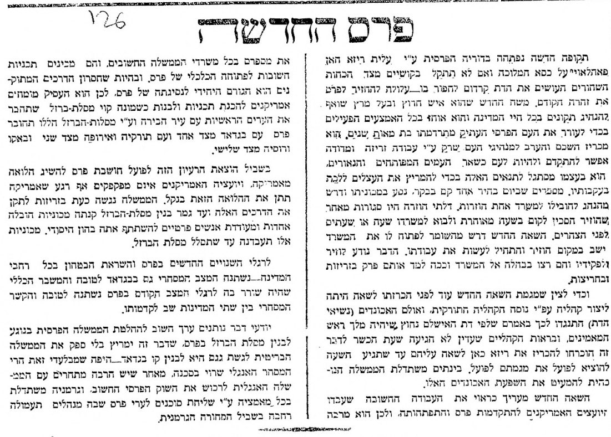

השאה החדש שואף לעורר את העם הפרסי מתרדמתו, ומכריז כי רק על ידי עבודה זריזה אפשר להפוך לעם מפותח ונאור.

השאה גם מעריך את עבודתם של היועצים האמריקנים להתקדמות פרס ולכן מרבה את מספרם בכל משרדי הממשלה.

הידיעה המלאה:

