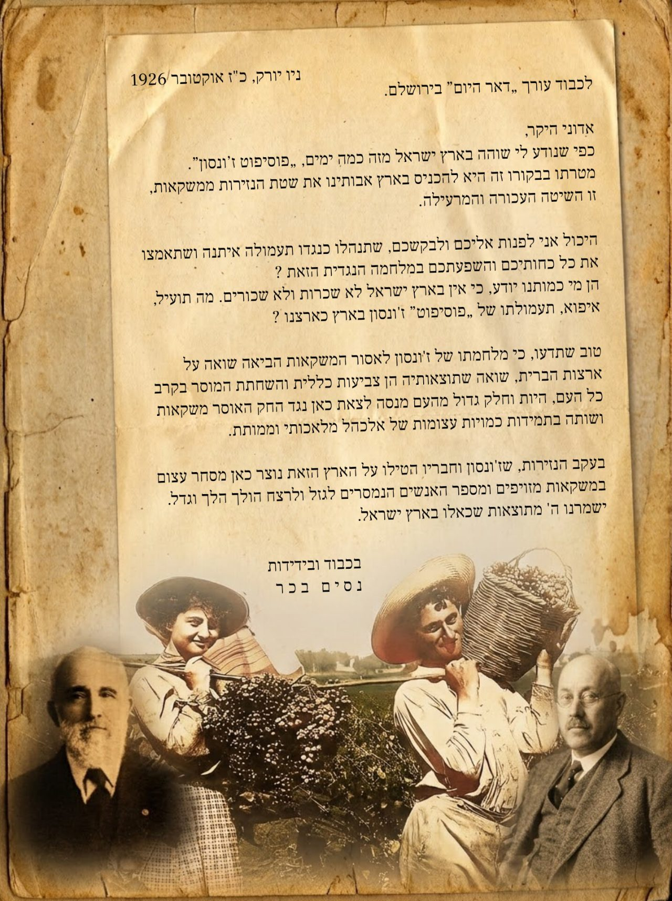

האדון ז'ונסון, המכונה "פוסיפוט ז'ונסון", אשר ידוע בכל העולם כולו בשל תעמולתו לטובת הנזירות ממשקאות, ביקר לפני כמה שבועות במצרים ובארצנו.

במצרים נתקבל בכבוד גדול על ידי המושלמים. בציינו שהקוראן אוסר עליהם שתיית משקה חריף, הביע הנסיך המצרי עומר טוסון תקווה, שבקרב הימים יסגרו במצרים כל בתי הקהוה והמסעדות מוכרי היין כ"אמריקה המאושרה".

אך בירושלים לא הצליח האדון ז'ונסון לעשות כל רושם על הקהל, ורישומו לא ניכר כלל מחוץ לחוגים צרים אחדים.

בקשר לביקורו, שלח העסקן הציבורי המכובד נסים בכר, את המכתב הבא, ובו הוא מותח ביקורת חריפה על תעמולת הנזירות של ז'ונסון:

~~~
ניו יורק, כ"ז אוקטובר 1926

לכבוד עורך „דאר היום” בירושלם.
אדוני היקר,
כפי שנודע לי שוהה בארץ ישראל מזה כמה ימים, „פוסיפוט ז’ונסון”.
מטרתו בבקורו זה היא להכניס בארץ אבותינו את שטת הנזירות ממשקאות, זו השיטה העכורה והמרעילה.

היכול אני לפנות אליכם ולבקשכם, שתנהלו כנגדו תעמולה איתנה ושתאמצו את כל כחותיכם והשפעתכם במלחמה הנגדית הזאת ?
הן מי כמותנו יודע, כי אין בארץ ישראל לא שכרות ולא שכורים. מה תועיל, איפוא, תעמולתו של „פוסיפוט” ז'ונסון בארץ כארצנו ?

טוב שתדעו, כי מלחמתו של ז'ונסון לאסור המשקאות הביאה שואה על ארצות הברית, שואה שתוצאותיה הן צביעות כללית והשחתת המוסר בקרב כל העם, היות וחלק גדול מהעם מנסה לצאת כאן נגד החק האוסר משקאות ושותה בתמידות כמויות עצומות של אלכהל מלאכותי וממותת.

בעקב הנזירות, שז'ונסון וחבריו הטילו על הארץ הזאת נוצר כאן מסחר עצום במשקאות מזויפים ומספר האנשים הנמסרים לגזל ולרצח הולך הלך וגדל.
ישמרנו ה' מתוצאות שכאלו בארץ ישראל.

בכבוד ובידידות
נסים בכר
~~~

על הפרשייה כותב "דאר היום": מכתבו זה של גדול עסקנינו ימצא הד רב בכל ארץ ישראל. שום אדם כאן לא ירצה לתת את צווארו בעול חוקה שאינה נחוצה לעברים, הידועים בעולם כולו בפכחותם הרבה בענייני משקאות, והראיה לכך היא שחברת "כרמל מזרחי", מוכרת בארץ ישראל כולה פחות יינות ושאר משקאות מאשר במצרים שכנתנו.

